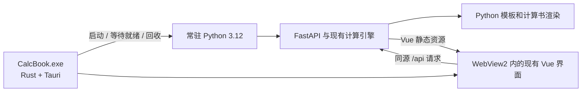

# CalcBook Windows 桌面版架构与验收记录

面向 Windows 10/11 x64，使用 Tauri 2 和 Python 3.12。用户解压便携包后双击 `CalcBook.exe`，沿用 Vue 界面、Python 模板和 `.cbproj` 工程文件。启动、计算与报错期间均使用桌面窗口。

## 架构

- **桌面宿主**负责窗口、运行时定位、启动进度、错误提示和日志。它启动一次 Python，单件与批量计算复用该进程。Rust 发布版使用 Windows 图形子系统，子进程使用 `CREATE_NO_WINDOW` 启动。后台输出记录到应用日志。 [Rust 图形子系统](https://doc.rust-lang.org/reference/runtime.html#the-windows_subsystem-attribute) · [Windows 进程创建参数](https://learn.microsoft.com/en-us/windows/win32/procthread/process-creation-flags)
- **应用界面**从 FastAPI 加载 wheel 内已构建的 Vue 静态页。页面和 `/api` 同源，KaTeX、预览样式、表单与批量表格走现有入口。桌面窗口使用 WebView2。 [静态资源和文档样式](../../src/calcbook/server.py#L331) · [前端 API](../../web/src/api.js)
- **计算和工程**由现有 FastAPI、计算引擎和模板契约负责。桌面版直接打开旧 `.cbproj`，以模板 ID 和 hash 识别计算项。 [工程和导出接口](../../src/calcbook/server.py#L229)

## 宿主协议

1. Tauri 解析 Python 的绝对可执行路径和模板目录。默认使用 `CalcBook.exe` 同级的 `python/python.exe` 和 `examples/`。开发时可用 `CALCBOOK_PYTHON` 与 `CALCBOOK_TEMPLATES` 覆盖。宿主以无窗口方式调用 `python.exe -u -X utf8 -m calcbook.desktop --templates <目录>`，保持 stdin 管道打开并收集 stdout、stderr。
2. Python 内部桌面入口绑定 `127.0.0.1:0`，由系统分配端口。使用已绑定的套接字启动 Uvicorn，在服务实际监听后向 stdout 输出 `CALCBOOK_READY {"port":12345}`（一行、立即刷新）。桌面入口只接受回环地址的 Host，并关闭 Web 开发用的跨来源访问。`calcbook serve` 入口供浏览器使用。
3. Rust 只从本次子进程的就绪行读取端口，校验为有效非零端口，在 WebView2 载入 `http://127.0.0.1:<port>/`。页面发起现有的相对 `/api` 请求。Tauri 负责等待、启动超时和进程提前退出提示，错误指向应用日志。主 WebView 仅在本次回环地址获得 Tauri 窗口操作权限。Vue 顶栏挂载窗口按钮后隐藏系统标题栏，启动页与错误页使用系统标题栏。工作界面的普通窗口由宿主按显示缩放应用 24 个逻辑像素的外框圆角，最大化时清除外框裁剪。
4. Tauri 退出时关闭子进程的 stdin。Windows 后台先检查关窗管道，仅在有数据时读取，以免阻塞读取卡住 NumPy 首次加载。Python 收到 EOF 后让 Uvicorn 正常停机。Rust 等待有上限，超时则终止并回收自己启动的 Python。意外退出时，stdin 断开同样通知 Python 停机。

## 分发与运行时

- 发布脚本用锁定的 Rust 依赖构建 Tauri，安装 CalcBook wheel、pip 和常用模板库到嵌入版 Python 3.12。便携 ZIP 包含 `CalcBook.exe`、`python/`、`examples/` 和 `docs/`。目标机需已装 WebView2。 [发布脚本](../../tools/build_release.py) · [Python 嵌入版](https://docs.python.org/3.12/using/windows.html#the-embeddable-package)
- 构建时准备内置模板的环境。自定义模板的额外库由用户按 PyPI 包名安装到包内 Python。在线安装器、独立 WebView2 运行时和多版本 Python 由后续分发工作决定。
- 动态端口会让 `localStorage` 和 IndexedDB 在每次启动时使用不同的页面来源，因此主题、导出偏好和保存句柄仅在同次运行中可用。工程通过 `.cbproj` 文件保存，并可在重启后重新打开。 [工程保存逻辑](../../web/src/store.js)

## 桌面验收记录

- Windows 11 x64 从资源管理器双击 Release 程序。8317 端口已被占用，Tauri 通过本次启动的回环地址载入 Vue。观察期间没有控制台窗口显示事件，实际 Python 3.12.10 在模板加载和计算时的控制台句柄均为 `0`。
- 使用旧钢梁工程在桌面窗口完成单件重算和两行批量重算。原版与桌面版的比值分别为 0.443、2.215，判定一致。HTML 和 Markdown 导出均可读取，离线 HTML 在禁止联网的浏览器环境中渲染出公式。
- 中文路径的 `.cbproj` 原地保存后，通过 Python 重新读取并逐字段核对版本号、参数、依赖 hash 和视图设置。历史无版本号工程按 v1 加载。
- 缺少 Python 时窗口显示中文错误与日志路径。缺少模板依赖时预览显示原因。就绪前关窗与正常关窗均验证宿主和 Python 退出。模拟后台异常停止时，下一次重算在界面显示请求失败。
- Python 3.12 回归 104 项、Rust 回归 8 项通过，Vite 构建、Rust 格式检查与 Clippy 通过。使用 Uvicorn 的最低支持版本 0.29.0 也验证了就绪握手和退出。
- 雨篷板简图在并发计算时可能出现中文缺字。模板在绘图期间修改并恢复进程共享的字体设置，并发时 Matplotlib 报缺字且图片内容变化。
- 外框曲线通过 Win32 窗口区域裁剪生效。自绘窗口关闭系统落影，保持轮廓边缘干净。四条直边沿用原生缩放。右下圆弧内侧通过主 WebView 的窗口权限启动原生斜向缩放，命中范围留在卡片外侧。在 Windows 11 的 100% 缩放下验证了四角、最大化、还原、960px 窄窗、最小化和关窗回收。DPI 换算由 Rust 测试覆盖。
- 便携包从 ZIP 解压至含中文和空格的目录后，以移除系统 Python 搜索路径的环境启动。包内 Python 能打开旧工程、完成单项和批量计算、通过雨篷冷启动。实测右下角斜向缩放和关窗回收。离线 HTML 在断网浏览器中渲染公式。包内 Python 102 项、Rust 19 项回归通过。