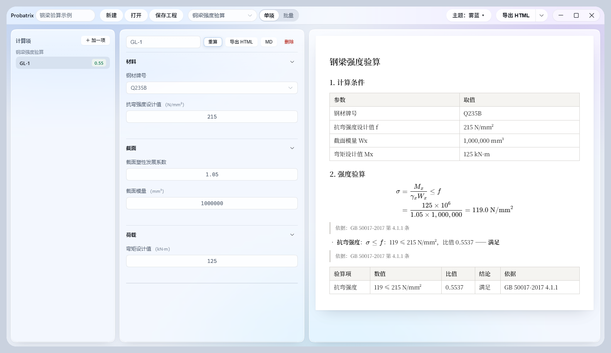

# CalcBook · 计算书工具


结构设计中「小构件」的批量计算与计算书生成工具。

解决的问题：验算小软件不能批量输入参数；Excel 能批量但复杂公式难写、卡、导出计算书要手动排版。

思路：**用 Python 写计算模板**（想多复杂写多复杂），**参数在表格里批量输入**（支持从 Excel 粘贴），
**计算书由模板生成 Markdown + LaTeX**（无代码、可打印），工程文件保存全部参数可复现。

## 安装与启动



*界面：左侧参数设置，右侧计算书实时预览（KaTeX 渲染）；批量表格支持 Excel 粘贴。*

```bash
pip install calcbook        # 或从源码：pip install .
calcbook serve              # 启动本地服务并自动打开浏览器
```

默认地址 `http://127.0.0.1:8317`（被占用时自动向后递加找空闲端口，启动信息会打印实际地址），
模板目录默认 `~/CalcBook模板/`。

```bash
calcbook serve --templates D/我的模板 --port 8317
```

**桌面窗口模式**（不弹浏览器，Win10/11 自带 WebView2）：

```bash
calcbook serve --ui webview
```

> 界面构建产物已随包分发（`src/calcbook/web/`），**使用侧不需要 Node**；
> 只有改前端代码时才需要 `cd web && npm install && npm run build`。

**离线分发包**（不依赖 PyPI）：`release/calcbook-<版本>.zip` 内含 `CalcBook.exe`
启动器 + `python/`（**内置 Python 3.12，已预装 calcbook 及全部依赖**：
numpy/scipy/pandas/matplotlib/openpyxl 等）+ `examples/` 模板。
解压后双击 `CalcBook.exe` 即用：**完全离线**（不依赖系统 Python、不写注册表，
删目录即完全卸载），以桌面窗口启动服务（全程无命令行窗口，完整日志在包目录
`calcbook.log`，实际服务地址显示在窗口顶栏右侧）。仅当模板声明的第三方库
（`__calcbook_requires__`）在包内缺失时，启动器才会用内置 pip 从国内镜像
自动补装（这是唯一的联网场景）。
构建方式 `python tools/build_release.py`。

## 写一个计算模板

> **完整的模板开发者文档见 [`docs/模板开发指南.md`](docs/模板开发指南.md)**——参数声明、CalcBook API、插图、单位纪律、调试方法。

一个模板 = 一个 `.py` 文件，放进模板目录即被自动扫描。两部分：**参数声明** + **计算书写法**。

```python
# gl.py —— 钢梁强度验算
from pydantic import BaseModel
from calcbook import CalcBook, Field, template


class GLParams(BaseModel):
    """参数声明：label/unit/choices/group 直接驱动界面。"""
    steel: str = Field("Q235B", label="钢材牌号",
                       choices=["Q235B", "Q355B"], group="材料")
    fy: float = Field(215, label="抗弯强度设计值", unit="N/mm²", group="材料", gt=0)
    gamma_x: float = Field(1.05, label="截面塑性发展系数", group="截面", ge=1.0, le=1.25)
    Wx: float = Field(1.0e6, label="截面模量", unit="mm³", group="截面", gt=0)
    Mx: float = Field(100, label="弯矩设计值", unit="kN·m", group="荷载")


@template("钢梁强度验算", description="GB 50017-2017 弯曲正应力验算")
def calc(p: GLParams) -> CalcBook:
    b = CalcBook(title="钢梁强度验算")
    sigma = p.Mx * 1e6 / (p.gamma_x * p.Wx)          # kN·m → N·mm

    b.h2("1. 强度验算")
    b.formula(r"\sigma = \dfrac{M_x}{\gamma_x W_x} \le f",
              cite=("GB 50017-2017", "4.1.1"))        # 符号公式 + 规范依据
    b.subs(rf"\sigma = {sigma:.1f}\ \mathrm{{N/mm^2}}")  # 代入数值
    b.check("抗弯强度", value=sigma, limit=p.fy, unit="N/mm²",
            expr=r"\sigma \le f", cite=("GB 50017-2017", "4.1.1"))
    return b
```

`b.check()` 会在正文输出判定行，并在计算书末尾自动汇总「验算结论」表；
`b.metric(name, 值)` 可为批量表格追加结果指标列（如选筋结果）；
批量表格每行也会显示最大应力比（超限标红）。

CalcBook 可用方法：`h1/h2/h3` 标题、`p` 文字、`formula` 符号公式、`subs` 代入式、
`check` 验算、`metric` 批量结果指标列、`image_bytes` 插图（matplotlib 截面/计算简图）、`table` 自由表格。

### 单位纪律

模板内部**统一用 SI 基本单位**（N、mm、MPa），换算写在取值处（如 `Mx*1e6`）；
`Field(unit=...)` 只负责界面展示。不做自动单位引擎。

### 依赖数据表

同目录的普通 `.py` 模块可直接 `import`（如国标截面表）：

```python
import Hsteel          # 与 gl.py 同目录
p.Wx = Hsteel.TABLE["HN400x200"]["Wx"]
```

改完模板代码，界面点「刷新模板」即可生效，无需重启服务。

## 使用流程

1. 选模板 → 界面自动生成参数表单
2. **单项**：左侧改参数，右侧实时预览计算书（防抖 300ms，与导出排版一致，所见即所得）
3. **批量**：表格一行一根梁；支持从 Excel 直接 Ctrl+V 粘贴；每行显示应力比与结论；
   行可复制/删除/上移/下移，列宽可拖动（单行显示下限），列多时横向滚动、名称列固定；
   顶部「统一设置」可把某组参数应用到全部行——各行取值不同的参数会标「＊」，
   留空则保持各行原值，填值应用即统一该列
4. 保存工程（`.cbproj`，纯 JSON：参数 + 模板 id + hash）→ 下次打开即复现
5. 导出 HTML（单计算项或整个工程分页合并）→ 浏览器 Ctrl+P 存 PDF
   - 默认导出走 KaTeX CDN，文件极小、需联网渲染公式；
   - 顶栏「⋯」菜单勾选「导出离线版」则内联样式与 woff2 字体（约 0.65 MB），断网/内网可直接打开

界面为 Notion 风格的米白画布，顶栏可切换三套浅色主题（米白/纯白/亚麻）。

模板 hash 变化时（模板代码改过），界面会提示「模板已改」，提醒旧结果可能失效。

## 开发与测试

```bash
pip install -e .
python -m pytest tests -q          # 契约 / 后端 / API 三层测试
cd web && npm install && npm run dev   # 前端开发模式（代理到 8317）
cd web && npm run build                # 构建到 src/calcbook/web/
```

设计决策与取舍见 [`计算书工具文档.md`](计算书工具文档.md)。

## 当前状态

MVP 已具备：模板加载与刷新、参数声明驱动界面、单项实时预览（与导出同源排版）、
批量表格（列显隐 / 统一设置 / Excel 粘贴 / 复制行 / 排序 / 列宽拖动）、
`.cbproj` 工程读写、模板 hash 校验、自包含 HTML 导出、三套浅色主题。

尚未实现：参数联动与派生（选截面型号自动带截面特性）、Word 导出、依赖模块 hash、
模板库集中分发。
