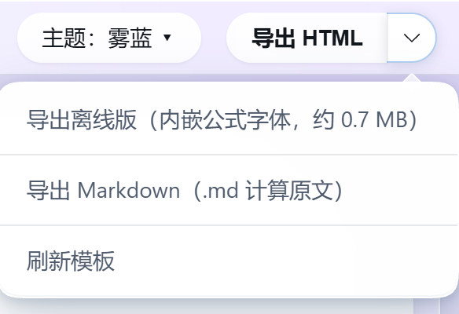
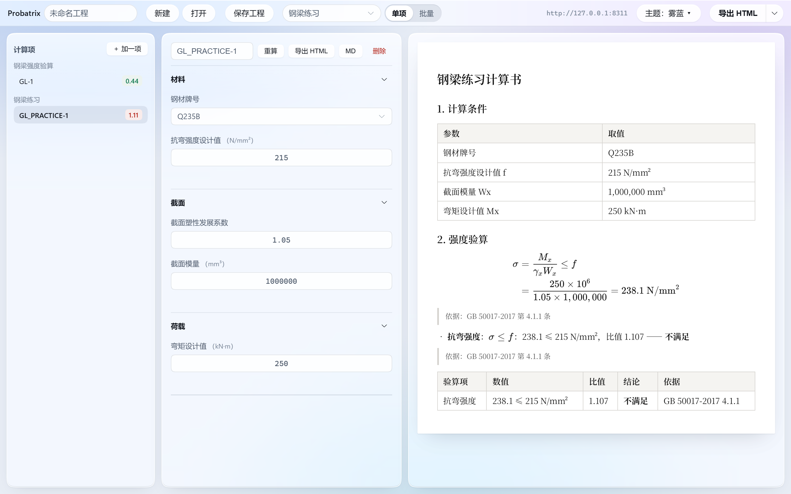

# 模板快速开始

把内置的钢梁模板复制一份，改成自己的模板，再用两个弯矩值跑出「满足」和「不满足」。这一篇只需会复制文件和编辑文字。软件的安装和启动见《使用说明》。[使用说明](01-使用说明.md)

## 1. 用内置模板先算一次

1. 打开 Probatrix，在顶部「选择模板」中选「钢梁强度验算」，切到「单项」。首次选中时，软件会自动创建一个计算项。如果这个模板已有计算项，可以点左侧「＋ 加一项」用默认值开始练习。
2. 中间是参数表单。展开「荷载」，确认「弯矩设计值」为 `100 kN·m`，其余参数保留默认值。
3. 看右侧计算书的「强度验算」。默认截面模量为 `1000000 mm³`，塑性发展系数为 `1.05`，抗弯强度设计值为 `215 N/mm²`。应力约为 `95.24 N/mm²`，验算比值约为 `0.443`，结论为「满足」。

## 2. 复制模板并改两处名称

用 Windows 便携版时，在 `Probatrix.exe` 同一级打开 `examples` 文件夹。把其中的 `gl.py` 复制到同一文件夹，给副本取名 `gl_practice.py`。

```text
Probatrix 解压目录/
├─ Probatrix.exe
└─ examples/             ← 软件读取的模板目录
   ├─ gl.py              ← 内置钢梁示例
   └─ gl_practice.py     ← 你的副本
```

用浏览器版时，`probatrix serve --templates examples` 读取运行命令时所在目录下的 `examples`。如果启动时指定了其他模板目录，就把 `gl.py` 的副本放进指定的目录。[钢梁示例 `gl.py`](../../examples/gl.py)

用记事本或 VS Code 打开 `gl_practice.py`。先找到以 `@template(` 开头的一整行，把它替换成下面这一行。第一个引号里的文字会出现在软件顶部的模板下拉框里。

```python
@template("钢梁练习", description="从内置钢梁模板复制")
```

再找到 `b = Probatrix(title="钢梁强度验算")` 那一行。把引号里的标题换成「钢梁练习计算书」，让右侧计算书也带上自己的名字。这一行在计算函数里面，开头保留四个空格。

```python
    b = Probatrix(title="钢梁练习计算书")
```

用 UTF-8 编码保存。遇到文件类型不对，在资源管理器里打开「文件扩展名」显示，确认实际文件名是 `gl_practice.py`。

## 3. 刷新模板并打开副本

打开顶栏「导出 HTML」按钮右侧的小箭头，点「刷新模板」。然后在顶部模板下拉框选「钢梁练习」。中间出现和内置钢梁相同的输入框，右侧标题变为「钢梁练习计算书」，就说明软件已经载入并执行了你的副本。



## 4. 改一个输入，核对结果

把「弯矩设计值」从 `100` 改成 `250`，按 Enter 或点到输入框外。其余参数取默认值时，右侧应力变为约 `238.1 N/mm²`，比值约为 `1.107`，结论为「不满足」。在中间栏点「导出 HTML」可以保存当前这一项的计算书。



## 回到代码里找这三段

| 在 `gl_practice.py` 里找 | 这段负责什么 |
|---|---|
| `class GLParams(BaseModel):` 下面的 `Field(...)` | 列出参数。每个参数写了类型、默认值、界面名称等信息，软件用它生成表单。 |
| `def calc(p: GLParams)` 下面的 `sigma = ...` | `calc` 是软件每次重算时执行的函数。`p` 是这一次的全部输入，`p.Mx` 就是本次输入的弯矩。 |
| `b = Probatrix(...)` 到 `return b` | `b` 用来逐段写计算书。`b.h2(...)` 加标题，`b.derive(...)` 排公式，`b.check(...)` 做验算。`return b` 把写好的计算书交回软件。 |

`from ... import ...` 是文件开头的导入语句，让模板能使用 `BaseModel`、`Field` 等工具。照着示例改代码时，保留行首缩进，用英文引号、括号和逗号。`#` 后面是给人看的注释。

## 遇到问题时怎么找

| 看见的现象 | 从哪里检查 |
|---|---|
| 下拉框没有「钢梁练习」 | 检查文件是否保存到本次启动使用的模板目录，扩展名是否为 `.py`，再点「刷新模板」。如果左栏出现「模板加载错误」，从对应文件的报错末尾查看行号和原因，例如缺少引号或缩进有误。 |
| 刷新后仍看到上一次的预览，或计算项标记「模板已改」 | 在单项点「重算」，或在批量点「全部重算」，用这项已有的输入重新取结果。要验证新的参数默认值，可以另外加一项。 |
| 右侧显示「参数校验失败」 | 看错误详情里的参数名和取值要求。例如 `Wx` 必须大于 `0`。 |
| 右侧显示「计算出错」 | 从错误详情的末尾找出错行号和原因，改好保存，刷新模板后重算。 |
| 右侧显示「模板返回值类型错误」 | 检查计算函数末尾是否有 `return b`，并确认它缩进在 `calc` 里面。 |

接下来按要改的位置阅读《参数输入界面》《计算与验算》或《计算书排版》。[模板开发指南](02-模板开发指南.md)
