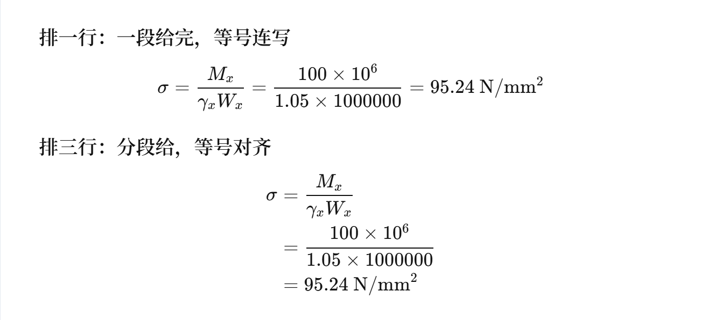

# 计算书排版

模板里的 `b` 是正在编写的计算书。`b.h2(...)`、`b.table(...)`、`b.derive(...)` 等语句按执行顺序把内容放进正文。以下片段用《模板快速开始》的 `gl_practice.py` 练习，改好保存后点「刷新模板」，再在单项点「重算」，看右侧预览是否符合预期。[模板快速开始](模板快速开始.md)

## 1. 先把计算条件和验算分开

`b = Probatrix(title="钢梁练习计算书")` 设置整本书的标题。`b.h1()`、`b.h2()`、`b.h3()` 分别添加一级、二级、三级标题，章节号可直接写在标题里。`b.p()` 写一段说明，`b.table()` 放计算条件或中间结果。

在钢梁练习中，用下面的片段替换从 `b.h2("1. 计算条件")` 到第一张表结束的部分。`b.table` 的第一个方括号是表头，第二个方括号里，每一对内层方括号是一行，内容按表头顺序填写。

```python
    b.h2("1. 计算条件")
    b.p(r"以下参数用于本次验算，$f$ 表示**抗弯强度设计值**。")
    b.table(
        ["参数", "取值"],
        [
            ["钢材牌号", p.steel],
            ["抗弯强度设计值 f", f"{p.fy:g} N/mm²"],
            ["截面模量 Wx", f"{p.Wx:,.0f} mm³"],
            ["弯矩设计值 Mx", f"{p.Mx:g} kN·m"],
        ],
    )
```

默认输入时，第一节会出现一行说明和一张四行的条件表，弯矩一行显示 `100 kN·m`。第二节继续放 `b.h2("2. 强度验算")`、推导和 `b.check(...)`。文末的验算汇总随 `check` 自动生成。[计算与验算](计算与验算.md#3-读结论和添加批量结果列)

## 2. 让公式、代入和结果依次出现

钢梁练习里，`sigma = ...` 是实际计算。它下面的 `b.derive(...)` 用来写给人看的公式。公式字符串采用 LaTeX 写法，例如 `\frac` 排分数、`\sigma` 显示希腊字母 σ。`derive` 的第一个参数是等号左边，后面每传一段就占一行，等号会自动对齐。

找到原来的 `b.derive(...)`，把整段替换为下面的内容。保留它前面的 `sigma = ...`，以及后面的 `b.check(...)`。

```python
    left = r"\sigma"
    symbolic = r"\frac{M_x}{\gamma_x W_x}"
    substitution = rf"\frac{{{p.Mx:g} \times 10^6}}{{{p.gamma_x:g} \times {p.Wx:.0f}}}"
    result = rf"{sigma:.2f}\ \mathrm{{N/mm^2}}"
    b.derive(left, symbolic, substitution, result)
```

默认弯矩 `100 kN·m` 时，预览会依次显示符号式、代入式和 `95.24 N/mm²`。希望把三段连排时，把最后一句换成下面的写法，用 ` = ` 把三段接成一个字符串。

```python
    b.derive(left, f"{symbolic} = {substitution} = {result}")
```



试排时把左边符号和各段的 LaTeX 源字符数加起来。总长在 120 个字符以内，先试单行。超过 120 时，用 `b.derive(left, symbolic, f"{substitution} = {result}")` 分成两行，第一行放符号式，第二行放代入和结果。第二行仍长时，拆成三段。`derive` 会按你传入的段数分行，可以在右侧预览确认每行宽度。等号左边的符号变了，就另起一条推导。括号内的补充说明放在对应推导的最后一段。

公式和代入也可以各出一个独立块。`b.formula(r"\sigma = ...")` 写符号公式，`b.subs(r"\sigma = ...")` 写随后的数值代入。两者都接受 `cite=("规范号", "条文号")`，填入项目实际采用的规范和条文。`derive` 接受同样的参数，在整条推导下方显示「依据」。`check` 上的引用会进入验算判定和汇总表。

### 把计算值和最终取值都写出来

例如某项计算得到 `68.2 mm²`，设计取值至少为 `200 mm²`。先在 Python 中算出实际采用的值，再用 `take` 在推导下面排一行「取」。

```python
    area_calc = 68.2
    area_min = 200
    area_used = max(area_calc, area_min)
    b.derive(
        r"A_s", rf"{area_calc:.1f}\ \mathrm{{mm^2}}",
        take=rf"\max({area_calc:.1f},\ {area_min:g}) = {area_used:.1f}\ \mathrm{{mm^2}}",
    )
```

### 读懂公式里的引号和花括号

- `r"..."` 让反斜杠原样进入公式，`f"..."` 可以把变量插入文字，`rf"..."` 两种作用都有。
- 在 `rf"..."` 里，`{sigma:.2f}` 是 Python 插入的数值。LaTeX 本身的花括号要写成双层，例如 `\mathrm{{N/mm^2}}` 会传出 `\mathrm{N/mm^2}`。
- `:g` 可以省略数字末尾多余的零，`:.2f` 保留两位小数。公式里用普通数字或 `\times 10^{...}` 写大数。条件表和文字中可以用 `f"{p.Wx:,.0f}"` 加千位分隔符。

## 3. 段落和整段 Markdown 怎么写

### 内容语法契约

`b.p()` 写段落，文本中的非空行逐行排成段落。标题、段落、表格单元格、图名这几类文本支持两种行内格式，分别是 `**粗体**` 和 `$...$` 行内公式。`## 标题`、`- 列表项`、链接、图片标记、单星斜体和 HTML 标签按文字显示。尖括号、`&` 和引号由软件做 HTML 转义。成对的 `**` 和 `$...$` 会按对应格式处理，普通文本中暂时没有专门的转义写法来显示这些成对标记。

长说明已经写成 Markdown 时，用 `b.markdown(...)` 排成正文。下面的多行文字可以放进 `calc`，换成项目实际的适用条件。

```python
    b.markdown("""### 适用条件

- 材料强度设计值按项目取用。
- 截面参数按本次输入取值。
""")
```

`markdown()` 支持井号标题、段落、围栏代码块、有序及无序列表、竖线表格、引用和分隔线。行内支持反引号代码、`**粗体**`、`$...$` 公式和 HTTP(S) 链接。本地链接在预览中显示为文字。Markdown 图片位置会显示图片说明，实际插图用下面的图片方法。软件里的「使用文档」示例也是通过 `markdown()` 读取手册正文。[文档示例 `manual.py`](../../examples/manual.py)

## 4. 插入截面简图或计算简图

手头已有 `section.png` 时，可以把它放在模板 `.py` 同一文件夹。在模板开头的导入语句旁加 `from pathlib import Path`，然后把下面两行放在 `calc` 中准备插图的位置。`__file__` 是模板自身的位置，`with_name` 找的是同目录的图片。

```python
    section = Path(__file__).with_name("section.png")
    b.image_bytes(section.read_bytes(), caption="截面简图")
```

`image_bytes` 默认把传入的数据当作 PNG 图片显示。插入 JPEG 时用 `mime="image/jpeg"`。图片会嵌入导出的 HTML，文件移动到其他目录或离线打开时也可看到。使用 `b.image("https://...", caption="截面简图")` 引用在线图时，查看者的浏览器要能访问对应网址。

图片默认居中。想把简图放右边、说明放左边，在 `b.image_bytes(...)` 里加 `side="right"`，紧跟一条 `b.p("图示为所采用的截面尺寸。")`。也可选 `side="left"`。之后的公式、表格、标题和判定行会回到全宽排版。

如果图随输入变化，可以用 matplotlib 绘图，将生成的 PNG 字节交给 `image_bytes`。内置「雨篷板计算」示例在 `_section_fig` 函数中把图保存到内存，再将图放进计算书。添加绘图库时同时声明模板依赖。[雨篷示例 `canopy.py`](../../examples/canopy.py) · [计算与验算](计算与验算.md#6-声明第三方库)

## 5. 从预览检查导出效果

改好排版后，先用默认参数检查条件、公式、验算结论，再用一组较长的输入检查公式和表格是否放得下。点单项的「导出 HTML」，用浏览器打开文件并查看打印预览。计算书预览和 HTML 导出共用正文排版，模板决定内容顺序和公式分行。打印成 PDF、离线导出及批量合并步骤见《使用说明》。[使用说明](使用说明.md#导出)
