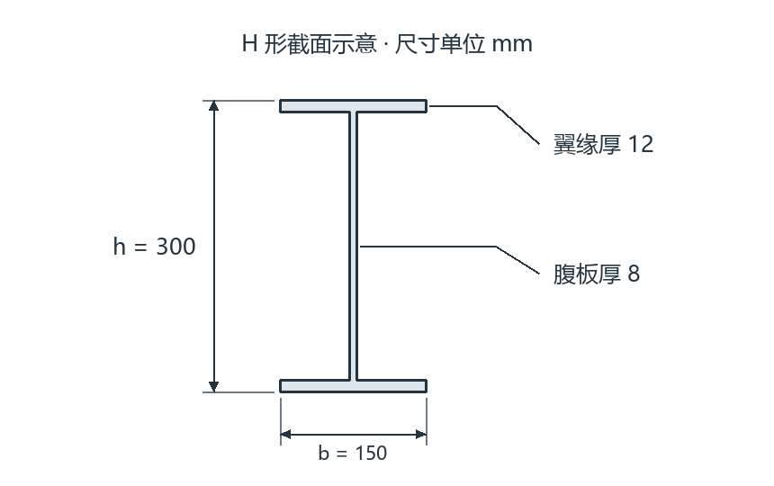

# H 形截面面积计算示例

## 截面与尺寸

本例将上下翼缘和腹板按三个矩形计算。截面高度为 300 mm，翼缘宽度为 150 mm，翼缘厚 12 mm，腹板厚 8 mm。

## 截面面积

$$A = 2bt_f + (h - 2t_f)t_w = 2 \times 150 \times 12 + (300 - 2 \times 12) \times 8 = 5808\ \mathrm{mm^2}$$
